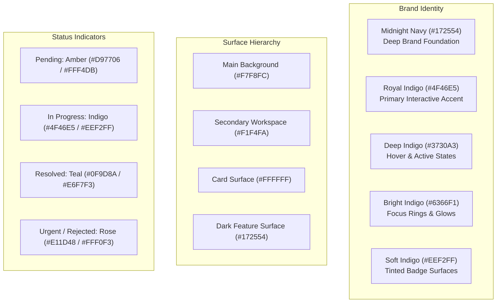
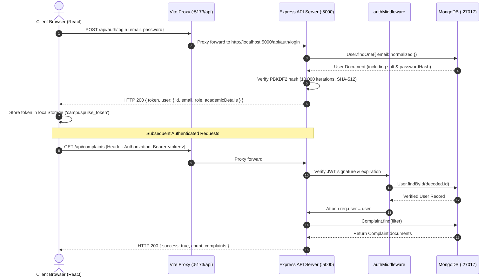

# CampusPulse — System Architecture & Engineering Specification

**Product:** CampusPulse — Smart Campus Issue Management  
**Company:** StackMitra  
**Tagline:** Projects Made Simple.  
**Version:** 2.0.0 Production Architecture  
**Author:** Full-Stack Architecture & Design Team  

---

## 1. Executive System Overview

CampusPulse is an institutional grievance redressal and facilities management web application engineered on the **MERN** (MongoDB, Express.js, React, Node.js) technology stack. The platform bridges communication between university students and campus administration, providing real-time tracking, department dispatch triage, and auditable grievance history.

### Core Architectural Pillars
- **Decoupled Architecture**: Clean separation between the React client (`client/`) and Express backend (`server/`).
- **Concurrent Development**: Orchestrated local development via `concurrently`, enabling dual-process execution with single-command startup.
- **Enterprise Design System**: Custom tokenized UI framework built on Tailwind CSS, Sora / DM Sans typography, and spring-physics micro-interactions.
- **Cryptographic Security**: Salted PBKDF2 hash stretching (10,000 iterations, SHA-512) for credentials and stateless HMAC-SHA256 JSON Web Tokens (JWT).
- **Relational Integrity in Document DB**: Native Mongoose schemas with indexed fields, subdocument arrays for audit timelines, and query optimizations.

---

## 2. Repository Directory Structure

```
Campuspulse/
├── client/                              # Modern React 18 Single-Page Application
│   ├── public/                          # Static assets and favicon
│   ├── src/
│   │   ├── components/
│   │   │   ├── admin/                   # Admin Header, Sidebar, Triage Modal
│   │   │   ├── layout/                  # Navbar, Footer, Page Shells
│   │   │   ├── student/                 # Student Sidebar, Timeline, Cards
│   │   │   └── ui/                      # Master Design System Reusable Atoms
│   │   │       ├── Badge.jsx            # Status & priority indicators
│   │   │       ├── Button.jsx           # Micro-interactive button variants
│   │   │       ├── Card.jsx             # Surface container with hover physics
│   │   │       ├── EmptyState.jsx       # Zero-state placeholders
│   │   │       ├── ErrorMessage.jsx     # Alert banner with dismiss
│   │   │       ├── Input.jsx            # Form inputs with floating labels & icons
│   │   │       ├── LoadingSpinner.jsx   # Indigo dual-ring SVG spinners
│   │   │       └── Select.jsx           # Accessible select drop-downs
│   │   ├── context/
│   │   │   └── AuthContext.jsx          # JWT session provider & role persistence
│   │   ├── pages/
│   │   │   ├── admin/                   # Admin Overview, Management Table, Analytics
│   │   │   ├── student/                 # Student Overview, Filing Form, Ticket Details
│   │   │   ├── LandingPage.jsx          # Institutional SaaS hero & features
│   │   │   ├── LoginPage.jsx            # Unified credential login with Admin quick-fill
│   │   │   └── RegisterPage.jsx         # Student onboarding with academic verification
│   │   ├── routes/
│   │   │   └── ProtectedRoute.jsx       # Role-based route guard (Student vs Admin)
│   │   ├── services/
│   │   │   ├── api.js                   # Axios HTTP client with Bearer interceptors
│   │   │   ├── authService.js           # Authentication API integration
│   │   │   └── complaintService.js      # Grievances & operational statistics API
│   │   ├── styles/
│   │   │   └── globals.css              # Custom font rules, keyframes, scrollbar
│   │   ├── App.jsx                      # Client route definitions
│   │   ├── index.html                   # HTML entry point with Google Fonts
│   │   ├── main.jsx                     # React DOM root bootstrapping
│   │   ├── package.json                 # Client dependencies & Vite scripts
│   │   ├── postcss.config.js            # PostCSS Autoprefixer plugin
│   │   ├── tailwind.config.js           # Master Design System color tokens
│   │   └── vite.config.js               # Dev server & /api reverse proxy
│   └── .env.example                     # Client environment template
│
├── server/                              # Node.js + Express REST API Server
│   ├── src/
│   │   ├── config/
│   │   │   └── db.js                    # Mongoose MongoDB connection pooling
│   │   ├── controllers/
│   │   │   ├── authController.js        # Registration, login, current user verification
│   │   │   ├── complaintController.js   # Grievance CRUD, status triage, timelines
│   │   │   └── notificationController.js# In-app notifications & read state
│   │   ├── middleware/
│   │   │   └── authMiddleware.js        # JWT verification, student & admin guards
│   │   ├── models/
│   │   │   ├── Complaint.js             # Grievance schema with timeline & department
│   │   │   ├── Notification.js          # Student notification delivery model
│   │   │   └── User.js                  # Academic profile & PBKDF2 auth model
│   │   ├── routes/
│   │   │   ├── authRoutes.js            # /api/auth routes
│   │   │   ├── complaintRoutes.js       # /api/complaints routes
│   │   │   └── notificationRoutes.js    # /api/notifications routes
│   │   ├── scripts/
│   │   │   ├── seedAdmin.js             # Idempotent Chief Administrator seeder
│   │   │   └── testIntegrationE2E.js    # Comprehensive automated 15-test verification
│   │   └── server.js                    # Express application entry point
│   ├── package.json                     # Server dependencies & test runner
│   └── .env.example                     # Server configuration template
│
├── docs/                                # Project Specifications & Guides
│   ├── ARCHITECTURE.md                  # This architectural reference
│   └── API.md                           # Comprehensive REST API documentation
├── package.json                         # Root orchestration & concurrent runner
└── README.md                            # Complete setup, usage, and operations manual
```

---

## 3. Technology Stack & Component Rationale

| Layer | Technology | Version | Rationale |
| :--- | :--- | :--- | :--- |
| **Frontend Framework** | React | `^18.3.1` | Declarative component model, stateful hooks, virtual DOM performance. |
| **Build Tooling** | Vite | `^6.2.0` | Ultra-fast Hot Module Replacement (ESM-based) and optimized Rollup production builds. |
| **Client Routing** | React Router DOM | `^6.30.0` | Nested routing, programmatic navigation, dynamic parameters, and declarative guards. |
| **Styling Engine** | Tailwind CSS | `^3.4.17` | Utility-first CSS, custom design tokens, zero runtime overhead. |
| **Iconography** | Lucide React | `^0.476.0` | Clean, accessible SVG icons with customizable stroke and sizes. |
| **HTTP Transport** | Axios | `^1.8.1` | Promise-based HTTP client with request/response interceptors for Bearer auth tokens. |
| **Server Runtime** | Node.js | `>= 18.0.0` | High-throughput asynchronous event loop with native ESM module support. |
| **Web Server Framework**| Express.js | `^4.21.2` | Robust, minimalist HTTP routing and middleware framework. |
| **Database Engine** | MongoDB | `>= 6.0` | Document-oriented JSON store with flexible schema adaptation and subdocuments. |
| **Object Data Modeling**| Mongoose | `^8.10.1` | Strongly typed schema validation, indexes, and pre/post query hooks. |
| **Session Security** | JSON Web Tokens (`jsonwebtoken`)| `^9.0.2` | Compact, stateless tokens signed with HMAC-SHA256 algorithm. |
| **Password Security** | Node.js `crypto` (PBKDF2) | Native | Cryptographically secure pseudo-random salt + 10,000 hash iterations via SHA-512. |
| **Process Manager** | Concurrently | `^9.1.2` | Single-command root execution of client and server processes in one terminal. |

---

## 4. Master Design System & Motion Architecture

### 4.1 Master Color Palette
The CampusPulse visual design system reflects an institutional SaaS aesthetic balancing high-contrast readability with deep sapphire tones:



### 4.2 Motion Physics & Micro-interactions
All interactive components implement tactile physics governed by custom cubic-bezier timing curves:
- **Default Easing**: `cubic-bezier(0.16, 1, 0.3, 1)` (snappy entry with soft stabilization).
- **Button Press**: `active:scale-[0.98]` tactile depression on mouse-down.
- **Card Hover Elevation**: `-translate-y-0.5` with shadow expansion (`shadow-card` to `shadow-elevated`).
- **Modal Transition**: `modalIn` animation combining subtle scale up (`0.95` to `1.0`) with opacity fade (`0` to `1`).
- **Accessibility**: Complete `@media (prefers-reduced-motion: reduce)` override eliminating transforms and shortening duration to `0.01ms`.

---

## 5. Security Architecture & Data Flow

### 5.1 Request Pipeline & JWT Verification


### 5.2 Access Control Rules
1. **Student Access**: Can file new complaints, view complaints associated with their email, track live timelines, and read personal in-app notifications.
2. **Administrator Access**: Controlled exclusively by the authenticated account `bhargavpasupuleti5@gmail.com`. Admins can inspect the campus-wide queue, modify ticket status (`pending`, `in-progress`, `resolved`, `rejected`), assign maintenance departments, set priority levels, append resolution findings, and view institutional analytics.

---

## 6. Database Schema Design

### 6.1 User Collection (`users`)
- `fullName` *(String, Required)*: Full student/admin name.
- `email` *(String, Required, Unique, Indexed, Lowercase)*: Institutional email address.
- `passwordHash` *(String, Required)*: PBKDF2 hexadecimal hash.
- `salt` *(String, Required)*: 16-byte random salt.
- `role` *(String, Enum: ['student', 'admin'], Default: 'student')*: Role descriptor.
- `branch` *(String)*: Academic department (e.g., Computer Science and Engineering).
- `yearOfStudy` *(String)*: Current year (1st Year through 4th Year).
- `section` *(String)*: Classroom section (e.g., 'A', 'B').
- `rollNumber` *(String)*: College hall ticket / registration number.
- `passwordResetTokenHash` *(String, Indexed, select: false)*: SHA-256 cryptographic hash of single-use reset token.
- `passwordResetExpiresAt` *(Date, select: false)*: Token expiration timestamp (15-minute validity).
- `tokenVersion` *(Number, Default: 0)*: Incremented upon password reset to revoke prior active JWT sessions.
- `createdAt` / `updatedAt` *(Date, Automatic timestamps)*.

### 6.2 Complaint Collection (`complaints`)
- `id` *(String, Unique, Indexed)*: Human-readable identifier format `#CP-XXXX`.
- `title` *(String, Required)*: Grievance headline.
- `description` *(String, Required)*: Detailed description of the problem.
- `category` *(String, Required)*: Department domain (Hostel, Electrical, Network, etc.).
- `location` *(String, Required)*: Physical campus location or room number.
- `status` *(String, Enum: ['pending', 'in-progress', 'resolved', 'rejected'], Default: 'pending')*.
- `priority` *(String, Enum: ['Low', 'Medium', 'High', 'Urgent'], Default: 'Medium')*.
- `studentName` *(String, Required)*: Submitting student name.
- `studentEmail` *(String, Required, Indexed)*: Submitting student email.
- `studentId` *(String)*: Student roll number or ID.
- `assignedTo` *(String, Default: 'Awaiting Department Assignment')*: Maintenance crew assigned.
- `resolutionNote` *(String)*: Formal closing remarks.
- `timeline` *(Array of Subdocuments)*:
  - `status` *(String)*
  - `note` *(String)*
  - `actor` *(String)*
  - `date` *(Date)*
- `createdAt` / `updatedAt` *(Date, Automatic timestamps)*.

### 6.3 Notification Collection (`notifications`)
- `userId` *(ObjectId, Ref: 'User', Indexed)*: Target student recipient.
- `complaintId` *(String, Required)*: Referenced grievance ID.
- `message` *(String, Required)*: Notification text.
- `read` *(Boolean, Default: false)*: Read/unread state.
- `createdAt` *(Date, Automatic timestamp)*.

---

## 7. Operational Resilience & Production Readiness

- **CORS Configuration**: Server handles both cross-origin requests and same-origin reverse-proxy requests via Express CORS middleware.
- **MongoDB Connection Resilience**: Connection retries with timeout bounds, logging connection states explicitly.
- **Fail-Safe Seeding**: `seedAdmin()` script guarantees existence of Chief Administrator on boot without overriding existing credentials.
- **Automated Verification**: Self-contained integration test suite (`npm test`) verifies all 15 endpoints against live MongoDB data.
